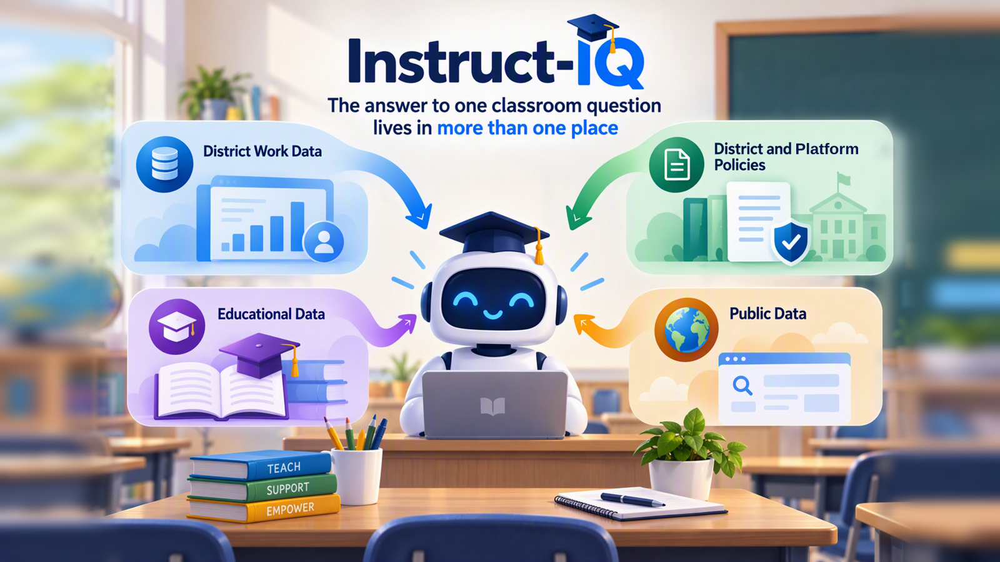

# Instruct IQ



> Synthetic instructional data only. Teacher review is required. Nothing is
> automatically assigned, graded, or published.

Instruct IQ helps educators bring information from multiple back-end systems
together to plan instruction. Assessment results, curriculum resources, learner
supports, and teaching-team context often live in different places. Instruct IQ
connects that evidence so educators can ask questions, understand learning needs,
and prepare instruction without piecing everything together by hand.

The project is for any educator looking to use the systems and resources available
to them to support their teaching. Educators remain in control: generated content
is a draft to inspect, adapt, and approve, not a replacement for professional
judgment.

The current reference implementation uses Microsoft IQ services and demonstrates
turning Friday's assessment into Monday's differentiated lesson for a synthetic
24-student, seventh-grade science class. This classroom is a worked example, not
a limit on the project's intended audience; additional settings and back-end
systems require appropriate integration and validation.

## Teacher experience

Ask questions about an authorized class using classroom chat, or select a class
and assessment to generate a teaching package. Inspect the supporting evidence
and edit the draft before exporting it. The package includes provisional
instructional groups, a shared objective, differentiated scaffolds, a 35-minute
lesson, and an exit ticket with an answer key.

Missing submissions are insufficient evidence, not evidence of low mastery.
Mandatory curriculum, authorized supports, and approved scheduling constraints
take precedence over informal collaboration.

## Connecting instructional evidence

Different systems contribute different parts of the instructional picture. The
current implementation uses the following services to retrieve that evidence;
it does not yet provide plug-and-play connections to arbitrary school systems.

| Instructional evidence | Current service | Role |
| --- | --- | --- |
| Assessment data | Fabric IQ | Assessment responses and item-to-skill evidence |
| Curriculum and learning resources | Foundry IQ | Approved curriculum, resources, supports, and requirements |
| Teaching-team collaboration | Work IQ | Requested teaching-team context, when available |
| Public instructional resources | Web IQ | Explicitly requested authoritative instructional enrichment |

Fabric and Foundry are required for a grounded core package. Missing connections
produce explicit blocked or partial results, never a synthetic runtime fallback.
Synthetic seed assets populate new cloud resources; automated tests may use
provider doubles.

## Educator control and responsible use

The included classroom data is synthetic. The project is not a ready-to-use
production student-data system. Any use with real learner information requires
appropriate privacy, security, access-control, and institutional review.

Class authorization is enforced before evidence is retrieved. Missing submissions
are not treated as low mastery, and generated plans remain subject to educator
review. Nothing is automatically assigned, graded, or published.

## Implementation status

Instructional contracts, synthetic data generation, a policy engine, authenticated
API routes, and the teacher workspace are implemented. Live adapter integration,
new infrastructure, and deployed acceptance are still in progress. A successful
unit test or frontend build does not establish a connected deployment.

Legacy code from an earlier use case remains in the tree while its replacements
are validated. It is not the active teacher experience.

## API

- `GET /api/instruct/v1/classes`
- `POST /api/instruct/v1/chat`
- `POST /api/instruct/v1/plan`
- `POST /api/instruct/v1/plan/stream`
- `GET /api/instruct/v1/classes/{class_id}/plans/{plan_id}/evidence/{ref_id}`

Class authorization precedes retrieval and evidence access. REST and streaming
responses use the same instructional pipeline. Browser-local draft storage is
opt-in and intended for synthetic data; editing resets review state and affected
generated citation support. Markdown and JSON exports preserve provenance.

The classroom chat requests `text/event-stream` to show live model, IQ retrieval,
and answer-validation status in the backend activity panel. Completed steps retain
their duration, source count, and availability reason. Sources not called remain
not requested; Web browsing is not enabled in chat. Answers remain buffered until
references and classroom access are validated. JSON chat clients remain supported.

Answers select only the evidence they actually use, not the full retrieval
inventory. Prose citations appear beside supported statements; selected observed
records retain their complete evidence provenance inside the collapsed records
section, separate from the answer's source list. General advice and clarifying
questions need no citations.

Once classroom scope is resolved, the model can request Fabric, Foundry, and Work
retrievals together. The server authorizes the entire batch before starting it,
runs independent sources concurrently, and merges their results before the next
model call. Each source keeps its own status and timing. Dependent lookups remain
sequential, and all calls share the existing bounded tool budget.

## Development

Prerequisites: Python 3.12+, Node.js 22+, npm, and PowerShell. Install backend
dependencies from `services\api\requirements.lock.txt` and frontend dependencies
from `apps\web\package-lock.json` when setting up the environment.

Run the backend from `services\api`:

```powershell
python -m uvicorn app.main:app --port 8000
```

Run the frontend in a second terminal:

```powershell
npm --prefix apps\web run dev
```

Configure frontend Entra sign-in and the API base URL, backend authentication,
explicit instructional class grants, and connected-provider coordinates before
using the instructional API. Development mode does not bypass instructional
authorization. The legacy `scripts\dev.ps1` launcher still forces commercial mock
settings and clears frontend authentication; it is not the connected instructional
launcher.

Validation from the repository root:

```powershell
$env:PYTHONPATH = "services\api"
python -m pytest services\api\tests
npm --prefix apps\web test -- --run
npm --prefix apps\web run lint
npm --prefix apps\web run build
```

## Infrastructure

The current implementation requires connected Microsoft IQ services and Azure
application resources. Infrastructure templates and service-specific setup notes
are included in the repository; review the
[infrastructure capability discovery](docs/infrastructure/instruct-iq-capability-discovery.md)
before provisioning. Use resources and identities authorized by your institution,
and keep new deployments isolated from existing environments.

A deployment is not ready until identity, ingestion, actual provider queries, and
the authenticated teacher journey have been verified.

## Documentation

- [Active implementation plan](docs/instruct-iq-implementation-plan.md)
- [Instructional contracts](docs/contracts/instruct-v1.md)
- [Infrastructure capability discovery](docs/infrastructure/instruct-iq-capability-discovery.md)
- [Original conversion plan](docs/instruct-iq-conversion-plan.md)
- [Synthetic instructional data](data/instruct/README.md)

## License

Licensed under the [MIT License](LICENSE).
